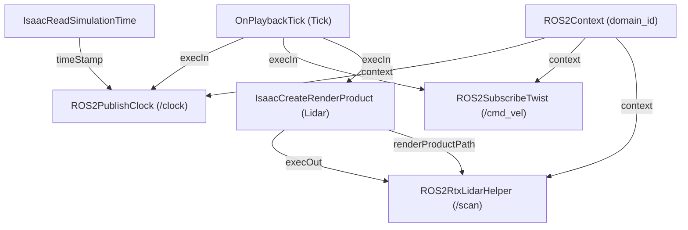

# Walkie-Isaac: NVIDIA Isaac Sim Integration for Walkie Bot

[](https://eic-robocup-2026.github.io/walkie-ros/)
[](https://docs.ros.org/)
[](https://docs.isaacsim.omniverse.nvidia.com/)

Standalone Isaac Sim simulation package and Git submodule for **Walkie Bot** in the [walkie-ros](https://github.com/EIC-Robocup-2026/walkie-ros) workspace.

---

## 1. Overview & Objective

Traditional Isaac Sim robotics workflows often rely on manual interaction with the Omniverse GUI—importing the robot USD, manually adding OmniGraph nodes (`ROS2PublishClock`, `ROS2SubscribeTwist`, `ROS2RtxLidarHelper`), and wiring input/output execution pins by hand on every launch. This manual workflow is error-prone, non-reproducible across teams, and incompatible with headless CI/CD.

**Walkie-Isaac** solves this with a fully automated, configuration-driven, and headless-ready simulation pipeline:
1. **Automated OmniGraph Action Graph**: Programmatically constructs the ROS 2 bridge graph at runtime using `og.Controller.edit`.
2. **Clean Stage Referencing**: Boots a clean stage, sets up PhysX physics and ground collision, and references `/World/walkie_bot` without carrying corrupted GUI viewport metadata from raw conversion tools.
3. **Automated Physics Variant Selection**: Automatically activates the `physx` variant, loading all 145+ joints (omni wheels, passive rollers, prismatic torso lift, and arm revolute joints).
4. **Configuration-Driven**: All physics rates, USD paths, LiDAR mount points, and ROS 2 topic names are driven by [`config/sim_config.yaml`](config/sim_config.yaml).
5. **Environment Isolation**: Runs cleanly with Isaac Sim's Python 3.12 runtime while communicating over standard ROS 2 DDS middleware with the Pixi workspace.

---

## 2. Directory Layout

```
walkie-isaac/
├── config/
│   └── sim_config.yaml              # Topic names, LiDAR specifications, physics step
├── assets/
│   └── Collected_gz_walkie_roller/  # Robot USD model, meshes, and physics payloads
│       ├── gz_walkie_roller_absolute_path.usda  # Root USD model (Physics variantSet)
│       └── payloads/                # Geometries, materials, PhysX/MuJoCo definitions
├── launch_sim.py                    # Standalone Isaac Sim Python runner
└── README.md                        # Documentation
```

---

## 3. Communication & Topic Specification

| Topic | ROS 2 Message Type | Direction | Purpose |
| --- | --- | --- | --- |
| `/clock` | `rosgraph_msgs/msg/Clock` | Isaac Sim $\rightarrow$ ROS 2 | Simulation time synchronization (`use_sim_time: true`). |
| `/cmd_vel` | `geometry_msgs/msg/Twist` | ROS 2 $\rightarrow$ Isaac Sim | Linear and angular velocity commands for base navigation. |
| `/scan` | `sensor_msgs/msg/LaserScan` | Isaac Sim $\rightarrow$ ROS 2 | 2D planar LiDAR for SLAM, costmaps, and obstacle avoidance. |

---

## 4. Quick Start

### Running from Workspace Root via Pixi

The root `walkie-ros` repository provides convenient tasks:

```bash
# Launch interactive GUI simulation
pixi run sim

# In a second terminal: teleoperate the robot base
pixi run teleop

# In a third terminal: list active simulation topics
pixi run topics
```

### Headless / CI Mode

To test or benchmark without opening the graphical interface:

```bash
# Run headless for 300 steps and exit cleanly
pixi run sim -- --headless --test --steps 300
```

### Running Standalone with Isaac Sim Python

You can also run the launcher script directly outside Pixi using your Isaac Sim Python environment:

```bash
export ROS_DISTRO=humble
export RMW_IMPLEMENTATION=rmw_fastrtps_cpp
export LD_LIBRARY_PATH=$LD_LIBRARY_PATH:/home/kay/IsaacLab/.venv/lib/python3.12/site-packages/isaacsim/exts/isaacsim.ros2.core/humble/lib

python3 launch_sim.py [--headless] [--test] [--steps <count>] [--config <path>]
```

---

## 5. Configuration Reference (`config/sim_config.yaml`)

```yaml
# Walkie Bot - Isaac Sim Configuration
# RoboCup 2027

simulation:
  headless: false
  physics_dt: 0.016666667   # 60 Hz physics step
  rendering_dt: 0.016666667 # 60 Hz rendering step

robot:
  usd_path: "assets/Collected_gz_walkie_roller/gz_walkie_roller_absolute_path.usda"
  prim_path: "/World/walkie_bot"

sensors:
  lidar:
    mount_prim_path: "/World/walkie_bot/Geometry/base_footprint/base_link/front_lidar_link"
    sensor_prim_path: "/World/walkie_bot/Geometry/base_footprint/base_link/front_lidar_link/RtxLidar"
    frame_id: "front_lidar_link"
    topic_name: "/scan"
    type: "laser_scan"      # "laser_scan" or "point_cloud"
    draw_debug: false
    horizontal_fov: 360.0
    min_range: 0.05
    max_range: 25.0

ros2:
  domain_id: 0
  clock_topic: "/clock"
  cmd_vel_topic: "/cmd_vel"
  scan_topic: "/scan"
```

---

## 6. Action Graph Pipeline Architecture

The launcher programmatically wires the following OmniGraph execution pipeline at `/ROS2_ActionGraph`:



---

## 7. Troubleshooting

| Symptom | Cause | Solution |
| --- | --- | --- |
| `ROS2 Bridge startup failed` | Isaac Sim cannot locate bundled ROS 2 shared libraries | Ensure `LD_LIBRARY_PATH` includes the Isaac Sim `isaacsim.ros2.core/humble/lib` path *before* starting the process. |
| `Topic not found` | Stage is stopped or paused | OmniGraph nodes use `OnPlaybackTick` and only publish while the timeline is playing (`timeline.play()`). |
| Conflicting Python packages | Host `PYTHONPATH` leaking into Isaac Sim | Ensure `PYTHONPATH` is unset before launching (handled automatically by `launch_sim.py` and `pixi run sim`). |
