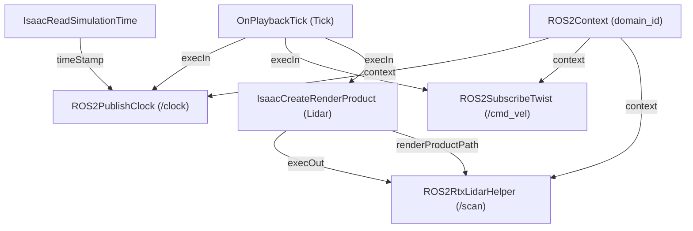

# Walkie-Isaac: NVIDIA Isaac Sim Integration for Walkie Bot

[](https://eic-robocup-2026.github.io/walkie-ros/)
[](https://docs.ros.org/)
[](https://docs.isaacsim.omniverse.nvidia.com/)

Standalone Isaac Sim simulation package and Git submodule for **Walkie Bot** in the [walkie-ros](https://github.com/EIC-Robocup-2026/walkie-ros) workspace.

---

## 1. Overview & Objective

Traditional Isaac Sim robotics workflows often rely on manual interaction with the Omniverse GUI—importing the robot USD, manually adding OmniGraph nodes (`ROS2PublishClock`, `ROS2SubscribeTwist`, `ROS2RtxLidarHelper`), and wiring input/output execution pins by hand on every launch. This manual workflow is error-prone, non-reproducible across teams, and incompatible with headless CI/CD.

**Walkie-Isaac** solves this with a fully automated, configuration-driven, and headless-ready simulation pipeline:
1. **Automated OmniGraph Action Graph**: Programmatically constructs the ROS 2 bridge graph at runtime using `og.Controller.edit`.
2. **Clean Stage Referencing**: Boots a clean stage, sets up PhysX physics and ground collision, and references `/World/walkie_bot` without carrying corrupted GUI viewport metadata from raw conversion tools.
3. **Automated Physics Variant Selection**: Automatically activates the `physx` variant, loading all 145+ joints (omni wheels, passive rollers, prismatic torso lift, and arm revolute joints).
4. **Configuration-Driven**: All physics rates, USD paths, LiDAR mount points, and ROS 2 topic names are driven by [`config/sim_config.yaml`](config/sim_config.yaml).
5. **Environment Isolation**: Runs cleanly with Isaac Sim's Python 3.12 runtime while communicating over standard ROS 2 DDS middleware with the Pixi workspace.

---

## 2. Directory Layout

```
walkie-isaac/
├── config/
│   ├── sim_config.yaml              # Topic names, LiDAR specifications, physics step
│   └── view_scan.rviz               # Pre-configured RViz display for LiDAR inspection
├── assets/
│   └── Collected_gz_walkie_roller/  # Robot USD model, meshes, and physics payloads
│       ├── gz_walkie_roller_absolute_path.usda  # Root USD model (Physics variantSet)
│       └── payloads/                # Geometries, materials, PhysX/MuJoCo definitions
├── walkie_isaac/                    # Modular simulation Python package
│   ├── __init__.py                  # Package initialization
│   ├── robot.py                     # Robot USD loader, PhysX variant, drive tuning & OmniBaseController
│   ├── sensors.py                   # RTX LiDAR and sensor creation module
│   └── ros2_bridge.py               # Action Graph builder & teleop Twist subscriber
├── launch_sim.py                    # Modular Isaac Sim simulation entrypoint
└── README.md                        # Documentation
```

---

## 3. Communication & Topic Specification

| Topic | ROS 2 Message Type | Direction | Purpose |
| --- | --- | --- | --- |
| `/clock` | `rosgraph_msgs/msg/Clock` | Isaac Sim $\rightarrow$ ROS 2 | Simulation time synchronization (`use_sim_time: true`). |
| `/cmd_vel` | `geometry_msgs/msg/Twist` | ROS 2 $\rightarrow$ Isaac Sim | Linear and angular velocity commands for base navigation. |
| `/scan` | `sensor_msgs/msg/LaserScan` | Isaac Sim $\rightarrow$ ROS 2 | 2D planar LiDAR for SLAM, costmaps, and obstacle avoidance. |

---

## 4. Quick Start & Execution Workflows

### 4.1 Recommended Multi-Terminal Workflow

Because the workspace communicates over Zenoh (`rmw_zenoh_cpp`), start `zenoh-router` first, followed by the simulation, bringup, and navigation:

```bash
# Terminal 1: Start Zenoh Router (required for node and service discovery)
pixi run zenoh-router

# Terminal 2: Launch Isaac Sim Walkie Bot Simulation
pixi run sim

# Terminal 3: Full ROS 2 Bringup (RSP with lift_at_top, ros2_control, RViz)
pixi run full-isaacbringup

# Terminal 4: Nav2 Navigation (AMCL localization + MPPI controller + Costmaps)
pixi run nav-sim
```

Alternatively, for SLAM mapping instead of pre-built map navigation:
```bash
pixi run slam-sim
```

---

### 4.2 Individual Component Tools

| Command | Description |
| --- | --- |
| `pixi run sim` | Launch Isaac Sim Walkie Bot GUI simulation with ROS 2 bridge |
| `pixi run zenoh-router` | Start Zenoh router daemon (`rmw_zenohd`) |
| `pixi run full-isaacbringup` | Full bringup: robot_state_publisher, controllers, self-filter, and RViz |
| `pixi run nav-sim` | Launch Nav2 localization (AMCL) and navigation (MPPI) |
| `pixi run slam-sim` | Launch SLAM Toolbox online mapping |
| `pixi run teleop` | Keyboard teleoperation for base movement |
| `pixi run test-joints` | Interactive joint control CLI for arms, lift, head, and grippers |
| `pixi run moveit-sim` | Launch MoveIt 2 motion planning for bimanual arms |
| `pixi run rviz-scan` | Launch RViz2 pre-configured for LiDAR `/scan` visualization |
| `pixi run rviz-sensors` | Launch RViz2 pre-configured for all robot sensors |
| `pixi run topics` | Inspect active ROS 2 topics |

---

### 4.3 Headless / CI Mode

To benchmark or test in automated CI pipelines without opening the GUI:

```bash
# Run headless for 300 physics steps and exit cleanly
pixi run sim -- --headless --test --steps 300
```

---

### 4.4 Build Guideline (Memory Safety)

> [!IMPORTANT]
> Nav2 and MoveIt compilation units consume 1.5–2.5 GB RAM each. To avoid laptop freezes or Out-Of-Memory (OOM) crashes, **always build with 1 parallel worker**:
> ```bash
> pixi run build-setup               # Builds with --parallel-workers 1 by default
> pixi run build-pkg -- <package>    # Rebuilds a single package
> ```

---

### 4.5 Standalone Execution with Isaac Sim Python

You can also run the simulation script directly with Isaac Sim's virtual environment:

```bash
export ROS_DISTRO=jazzy
export RMW_IMPLEMENTATION=rmw_zenoh_cpp
export AMENT_PREFIX_PATH=$CONDA_PREFIX
export LD_LIBRARY_PATH=$CONDA_PREFIX/lib:/home/kay/IsaacLab/.venv/lib/python3.12/site-packages/isaacsim/exts/isaacsim.ros2.core/jazzy/lib:$LD_LIBRARY_PATH

python3 launch_sim.py [--headless] [--test] [--steps <count>] [--config <path>]
```

---

## 5. Configuration Reference (`config/sim_config.yaml`)

```yaml
# Walkie Bot - Isaac Sim Configuration
# RoboCup 2027

simulation:
  headless: false
  physics_dt: 0.016666667   # 60 Hz physics step
  rendering_dt: 0.016666667 # 60 Hz rendering step

robot:
  usd_path: "assets/Collected_gz_walkie_roller/gz_walkie_roller_absolute_path.usda"
  prim_path: "/World/walkie_bot"

sensors:
  lidar:
    mount_prim_path: "/World/walkie_bot/Geometry/base_footprint/base_link/front_lidar_link"
    sensor_prim_path: "/World/walkie_bot/Geometry/base_footprint/base_link/front_lidar_link/RtxLidar"
    frame_id: "front_lidar_link"
    topic_name: "/scan"
    type: "laser_scan"      # "laser_scan" or "point_cloud"
    draw_debug: false
    horizontal_fov: 360.0
    min_range: 0.05
    max_range: 25.0

ros2:
  domain_id: 0
  clock_topic: "/clock"
  cmd_vel_topic: "/cmd_vel"
  scan_topic: "/scan"
```

---

## 6. Action Graph Pipeline Architecture

The launcher programmatically wires the following OmniGraph execution pipeline at `/ROS2_ActionGraph`:



---

## 7. Troubleshooting

| Symptom | Cause | Solution |
| --- | --- | --- |
| `sequence size exceeds remaining buffer` | FastDDS / ROSIDL distro mismatch between Humble bridge and Jazzy client | Isaac Sim must be set to `ROS_DISTRO=jazzy` with `LD_LIBRARY_PATH` pointing to `isaacsim.ros2.core/jazzy/lib` (configured by default in `pixi run sim`). |
| `Unable to connect to a Zenoh router after 1 attempt(s)` | Zenoh router is not running | The workspace defaults to `RMW_IMPLEMENTATION=rmw_zenoh_cpp`. Start the router with `pixi run zenoh-router` in a dedicated terminal before launching simulation or bringup. |
| `Waiting for service amcl/get_state...` or `version 'GLIBC_2.38' not found` | Host glibc (Ubuntu 22.04 with glibc 2.35) missing glibc 2.38 symbols from conda sysroot | Rebuild Nav2 with `pixi run build-pkg -- nav2_amcl` (or run `pixi run build-setup`). The workspace includes automatic symbol version compatibility shimming in `nav2_common/cmake/glibc_compat.h`. |
| `The class required for this panel, 'nav2_rviz_plugins/Navigation 2', could not be loaded` | Nav2 RViz plugin failed to load due to missing ISO C23 symbols | Resolved via compatibility wrappers in `nav2_rviz_plugins/src/nav2_panel.cpp`. Rebuild with `pixi run build-pkg -- nav2_rviz_plugins`. |
| Lift / torso at opposite positions in RViz vs Isaac Sim | Torso prismatic joint limits in Isaac Sim USD are inverted relative to URDF | Launch `robot_state_publisher` with `lift_at_top:=true` (already configured in `full_isaac_bringup.launch.py` and `pixi run rsp`). |
| `Message Filter dropping message: frame 'front_lidar_link' ... queue is full` | RViz is running on wall clock time OR missing TF transform to `map` | 1. Always launch RViz with `--ros-args -p use_sim_time:=true` (or run `pixi run rviz-scan`).<br/>2. When running standalone without bringup, set **Fixed Frame** to `front_lidar_link`. |
| `ROS2 Bridge startup failed` | Isaac Sim cannot locate bundled ROS 2 shared libraries | Ensure `LD_LIBRARY_PATH` includes the Isaac Sim `isaacsim.ros2.core/jazzy/lib` path *before* starting the process. |
| `Topic not found` | Stage is stopped or paused | OmniGraph nodes use `OnPlaybackTick` and only publish while the timeline is playing (`timeline.play()`). |
| Conflicting Python packages | Host `PYTHONPATH` leaking into Isaac Sim | Ensure `PYTHONPATH` is unset before launching (handled automatically by `launch_sim.py` and `pixi run sim`). |
